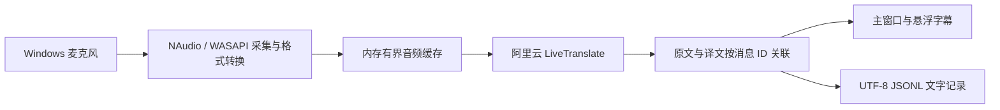

# 俄语课堂实时双语字幕（Windows）

当前 Windows 主链路使用 `qwen3.8-livetranslate-flash-realtime`，由同一条加密 WebSocket 连接接收原文和中文译文。

在 Windows 上安装 .NET 10 SDK（版本见 `global.json`），在项目目录运行 `powershell -ExecutionPolicy Bypass -File scripts/build.ps1`，构建并验证开发版。程序位于 `artifacts/development/Release/net10.0-windows/ClassroomCaption.exe`。使用前在应用的「模型连接」设置中填写自己的阿里云 API Key 和 Workspace ID。

API Key 保存在本机数据目录的 `credentials.json` 中。请将数据目录和通过 `-IncludeSavedConfiguration` 生成的个人 EXE 留在本机。公开构建使用不带该参数的发布命令。



## 模块

- `ClassroomCaption.App`：.NET 10、WPF 桌面界面；收音、音量提示、可拖动悬浮字幕、历史文字与设置。
- `LiveTranslateClient`：等待 `session.updated` 后发送 16 kHz、单声道、16 位 PCM 的 Base64 数据；只请求文字输出。停止时排空缓存、发送 `session.finish` 并等待 `session.finished`。
- `LiveTranslateState`：按 `previous_item_id` 关联输入消息和翻译消息，处理增量、乱序及重复事件。两侧完成后保存确认片段，中断片段保留为暂译。
- `CaptionEngine` / `CaptionPageComposer`：统一字幕数据与分页阅读；通用本地演示使用合成文字，不调用模型。
- `SessionStore`：增量保存文字和状态，读取旧课堂记录并导出；不保存音频。最近字幕在内存中有数量限制，较早已确认内容保存在会话文件。
- `SettingsStore`：阿里云 API Key、地域、Workspace ID、可选固定译法、保存位置和外观。密钥以明文保存在本机数据目录；已有配置中的未知旧字段读取时忽略。
- `AliyunBillingClient`：独立查询每日阿里云账户账单，使用另外授权的账务凭证；不参与实时翻译。
- `ClassroomProbe`：独立设备、目录和基础网络检测；模型鉴权须在主程序完成。

课程术语随 Core 资源提供。对应课件页码和术语来源见 [课程术语来源](docs/课程术语来源.md)。建立连接时合并词表，旧配置里的 `Glossary` 可覆盖内置译法。源语种由模型自动识别，目标固定中文。

主界面和悬浮字幕支持 WPF-Math 2.1.0 原生数学排版，分数呈上下结构，支持显式 LaTeX、上下标、根号与三角函数。显示层将 `x/y`、`x/(y+z)`、`x除以y` 转成对应分数；`x/y+z` 仍保持分母只有 y。日期、URL、连续除法和含糊的 `sin x/y` 不作分数猜测。`cosine`/`sinus` 与明确的希腊字母名称作统一显示；不根据课程公式自动补齐缺失项。部分尚未闭合的 LaTeX 更新先保留上一版，解析失败回退原文，不阻断翻译；公式作为整体参与改译动画、换行和滚动，较大公式缩放至可见范围。普通文字仍使用原有字形动画，原始课堂文字和历史文件不被显示格式改写。

麦克风下方的“本地降噪”可在翻译中切换，默认关闭并记住选择。采用 Xiph RNNoise 0.2 完整模型（本地 CPU 运行），在 48 kHz、单声道 PCM 上按 10 ms 帧处理，再转换为 LiveTranslate 需要的 16 kHz PCM。不需要虚拟声卡。两条音频路径均对齐约 20 ms 的滤波延迟，用 40 ms 淡化切换；停止时排空尾帧，不删除静音，不使用语音门限丢弃轻声。音量与过载提示基于降噪前的实际输入，“更多 → 试听”使用当前降噪选择，试听期间不切换。降噪可能改变语音细节，应实际对照选择；不保证提高俄语识别率。

费用显示服务端回报的输入与输出 token，不套用旧识别或翻译模型价格。用量缺失或延迟不代表免费，实际费用以阿里云账单为准。

## 验证与运行

```powershell
$env:DOTNET_CLI_HOME = Join-Path (Get-Location) '.tools\dotnet-home'
& '.\.tools\dotnet\dotnet.exe' run --project tests\ClassroomCaption.Tests -c Release
& '.\.tools\dotnet\dotnet.exe' run --project tests\ClassroomCaption.WindowsTests -c Release
```

显式真实连接检查：CoreTests 的 `--live-livetranslate <数据目录>` 会读取本地配置、发送 1 秒合成静音并验证收尾，可能产生少量用量，不采集麦克风、不打印密钥。它不证明真实课堂效果。

本轮只维护 Windows 版。`android/` 和既有发布包不属于本轮验证结果；已有 APK、单文件 EXE 不会因修改源码自动更新。历史修复报告位于 `docs/`，记录其当时版本，不代表当前架构。

## 构建

开发版入口为根目录的 `启动开发版.vbs`（无命令行窗口）。源码和资源未改变时直接启动，改变后才后台编译；源码、资源增删以及缺少运行依赖均会触发重新构建。当前开发输出统一为 `artifacts/development`，中间文件统一为 `artifacts/obj`。运行中的旧进程需先从托盘退出，才能使用更新后的代码。

`scripts/build.ps1` 默认只构建开发版并运行测试，不更新 `dist` 或生成发布包；仅显式传入 `-PortablePackage` 时发布压缩单文件。第三方许可参见 `THIRD-PARTY-NOTICES.txt`。

`scripts/clean-generated.ps1` 默认预览可清理的下载包、重复输出和旧构建缓存，传入 `-Apply` 才清理。它检查实际绝对路径、目录链接和运行中程序，保留课堂记录及原始资料。性能测试与清理清单位于 `artifacts/performance`。

RNNoise Windows x64 DLL 与许可随构建复制，无需安装开发运行库。重建本机降噪库：`powershell -File scripts/build-rnnoise.ps1 -Compiler <MinGW-w64-x64-gcc路径>`；脚本校验固定 v0.2 源码归档的 SHA-256，再编译不要求 AVX 的版本。来源与说明见 `native/rnnoise/README.md`。

精简发布：`powershell -File scripts/publish-compact.ps1`。采用自包含 Windows x64、LZMS 压缩的便携单文件，保留完整 WPF、字体与 RNNoise；不启用 WPF 不支持的程序集裁剪。首次启动自动展开到 `E:\课堂字幕\程序缓存\内容哈希\`，没有 E 盘时选 D 盘，之后校验并复用缓存。原生 DLL 的缓存也在该版本目录内，避免依赖重启后会还原的 C 盘。程序缓存与 `data` 分开，损坏时自动恢复；具体见 `docs/便携EXE缓存说明.txt`。开发版 VBS 入口不需要压缩或展开缓存。

明确需要携带已保存接入信息的私人版本时，加 `-IncludeSavedConfiguration`。只内嵌当前阿里云模型 Key 与设置，不带旧模型或账务凭证；新电脑首次运行写入本地 data，已有配置优先保留。设备选择与文字保存目录在新设备上重新初始化，不内嵌课堂记录。脚本仅在独立目录放置 EXE，执行离屏界面、字体、降噪及首次配置检查；不录音、不截屏、不调用模型。临时明文配置在构建后删除，原始配置与旧发布目录保留。

## 悬浮字幕外观

无可见外框、整块底板、顶部状态栏或缩放柄；展示范围自动覆盖当前屏幕的左右边界，俄文、中文分别显示最多三行，并随字号计算所需高度。两种语言之间仅保留很小的间距。各语言的多行底色在竖向连续连接，短行仍随文字收紧；整组统一应用透明度，交界处不会因重复叠加变黑。窗口空白像素完全透明，只能拖动文字底色块移动字幕，色块外围可操作下方课件。水平位置吸附当前屏幕边界，竖直位置可拖动；跨屏和DPI变化后重新适配。顶部旧行渐隐，其余行平滑上移，新行接续显示；完整文字保存在本地记录中。

“更多 → 字幕外观”可选择黑底白字或白底黑字，字色与底色成对切换。“底色透明度”默认25%，可调0%至100%，只改变底色，文字仍不透明；100%时底色隐藏，不再作为拖动目标。修改即时生效并保存到本地，重启后保留。悬浮窗不再启动屏幕背景采样，也不再设置截图排除。旧字色、底板浓度和采样开关保留于配置兼容层，不用于当前字幕外观。

悬浮字幕的文字缓冲随屏幕宽度与字号增加，避免宽屏下的三行区域仍受原固定字数限制；完整课堂文本继续独立保存。

中文字幕使用内嵌 Noto Sans SC Regular（思源黑体同源字体），主窗口行高49/字号32，悬浮中文行高为字号的1.5倍、俄语1.6倍。字体使用 SIL OFL 1.1，许可随软件提供。

## 改译过渡与设计稿

补字、删字、局部替换保留共同字形，替换仅在相邻不变文字所界定的原词位置发生；整句重译与大幅语序调整使用同步交叉淡化。等待新译文时保留上一版，临时回退到已翻译前缀也不会先删除旧尾句。更新在当前动画姿态上接续，不复播整句逐字动画。

规则与测试边界见 [字幕过渡设计](docs/字幕过渡设计.md)。
